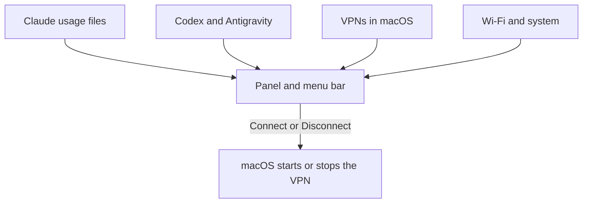
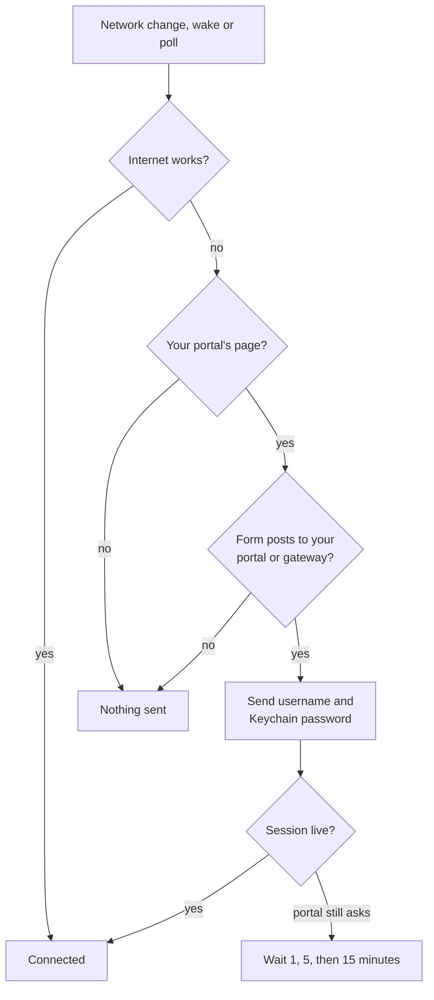

<h1 align="center">AI Meter Bar</h1>

<p align="center">AI quota, Claude profiles, VPN, network meters and Wi-Fi portal sign-in, in the macOS menu bar.</p>

<p align="center">
  
  
  
</p>

<p align="center">
  
</p>

## Features

- **AI quota.** Claude's 5-hour and weekly quota per account, plus live Codex and Antigravity quota. Every number shows its age. OpenCode, GitHub Copilot and Cursor show when they were last used.
- **Claude profiles.** Open a profile in one click, create one with its own launcher, or move one to the Trash.
- **VPN.** Connect or disconnect each VPN with one click, without opening the VPN app. A small shield on the menu bar icon shows one is up. Hide the ones you do not need.
- **Portal sign-in.** Signs in to a Wi-Fi login page by itself after a network change or wake. **Detect** finds a new portal's address for you.
- **Notifications (optional).** A sign-in that failed, a VPN that dropped, or a quota at 10% or less, once per reset.
- **Meters.** Speed, today's usage, 30-day history, CPU, RAM and memory pressure.
- **Light.** Live AI numbers are read only at launch and when the panel opens, and no helper stays running.

## How it works



Portal sign-in sends the password only after every check passes:



## Getting started

Requires macOS 26 or later on Apple Silicon and the Xcode Command Line Tools. There are no third-party dependencies.

```sh
cd macos-app
./build.sh --install
open "/Applications/AI Meter Bar.app"
```

1. Click the gauge in the menu bar to open the panel.
2. **Portal sign-in:** join the Wi-Fi while signed out. The panel says "This Wi-Fi has a login page"; click **Set up**, check the address **Detect** filled in, type the username and password, then **Save**.
3. **VPN:** a VPN shows up once it is listed in System Settings, VPN. For OpenVPN Connect this needs version 3.9 or later. Hide any VPN in **Settings**, **Display**.

## Settings

| Tab | What it holds |
| --- | --- |
| **Claude** | Which profiles appear, their names, colors and launchers |
| **Display** | Menu bar content, quota as left or used, units, which tools and VPNs appear |
| **Portal** | Auto-login, sign-in details, check interval, **Detect** and **Diagnose**, which read the portal and send nothing |
| **General** | Update interval, Wi-Fi interface, start at login, notifications, usage history, log, Quit |

## Scripts

| Command | What it does |
| --- | --- |
| `macos-app/build.sh` | Builds the app and a `.dmg`; `--no-dmg` skips the image, `--install` copies the app to `/Applications` |
| `macos-app/Tests/run.sh` | Unit tests |
| `macos-app/make-appicon.swift` | Regenerates the app icon |
| `macos-app/make-signing-identity.sh` | Run once: a local signing identity, so rebuilds stop asking for Keychain access; asks for your password |
| `discover-portal.sh` | Shows a portal's login form when **Detect** cannot read it; copy `config.example` to `config` first |

## Security and privacy

- The portal password lives only in the Keychain, and goes only to the Login URL's address, or to the Wi-Fi gateway once your portal marker matches.
- It is saved together with the Login URL and marker. If either is changed outside Settings, sign-in is refused until you save again.
- Logs never contain a password, portal address, IP or VPN name.
- The bar holds no AI login. Codex's own tool signs itself in and ends after answering; Antigravity is asked only on this Mac's loopback address.
- The VPN app keeps its profiles and passwords. The bar stores only the IDs of VPNs you hide.
- Portals use plain HTTP, so sign in only on networks you trust.

## Limits

- Claude's usage is only as fresh as Claude's last save. When Claude pauses its own check, use **Refresh** in Claude's menu bar menu.
- Antigravity's quota needs Antigravity to be open. Its local server and Claude's `--user-data-dir` option are not public interfaces, so an update could change them.
- One VPN app runs one tunnel at a time, so connecting a second profile of the same app ends the first.
- MikroTik CHAP portals are not supported. **Diagnose** tells you if a page looks like one.
- Builds are ad-hoc signed until you run `make-signing-identity.sh` or set `CODESIGN_IDENTITY`, so each rebuild asks once for Keychain access.
- The panel's glass popover costs macOS about 80 MB for a moment the first time it opens; the app itself stays near 40 MB.

Developer notes: [macos-app/README.md](macos-app/README.md).

## Credits

Tool marks come from [Lobe Icons](https://github.com/lobehub/lobe-icons) 1.98.0 (MIT). The trademarks belong to their owners, and the marks only identify each tool.

## Author

Built by [David Immanuel Widagdo](https://github.com/davidwidagdo). Licensed under [MIT](LICENSE).
