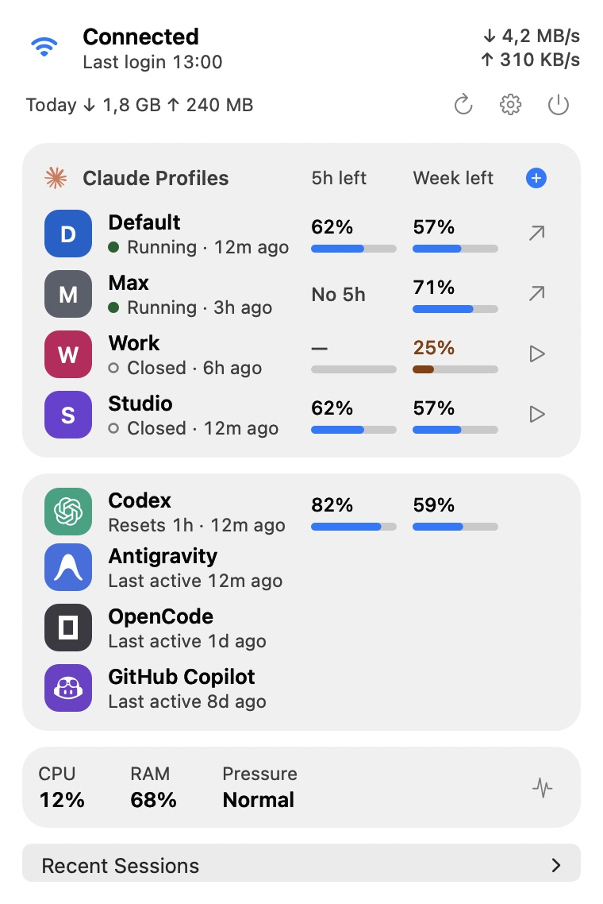
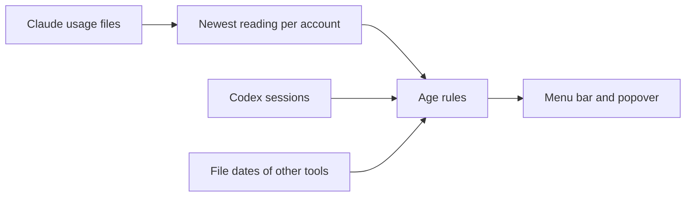
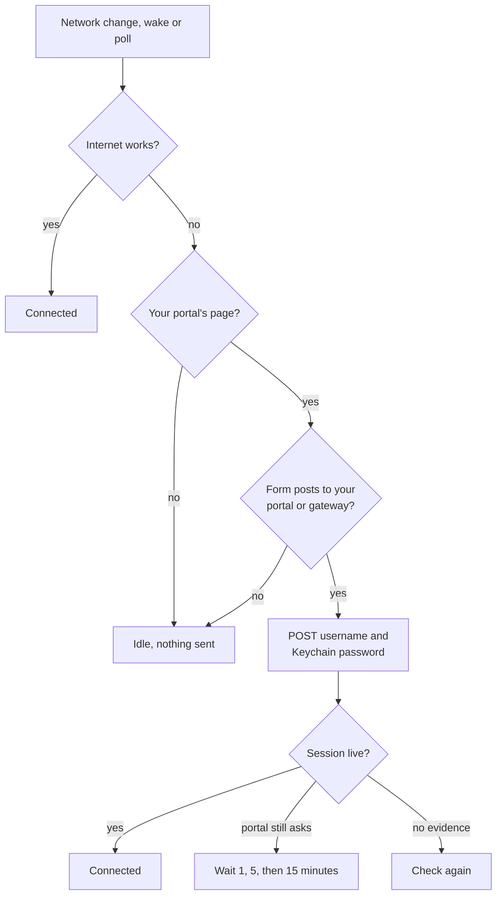

<h1 align="center">AI Meter Bar</h1>

<p align="center">AI quota, Claude profiles, network meters and captive-portal sign-in, in the macOS menu bar.</p>

<p align="center">
  
  
  
</p>

<p align="center">
  
</p>

## Features

- **AI quota.** 5-hour and weekly quota per Claude account, whatever the profile is called, plus Codex quota. Every reading shows its age.
- **Claude profiles.** Open any profile in one click, create one with its own launcher and no Automator step, or move one to the Trash.
- **Other tools.** Antigravity, OpenCode, GitHub Copilot and Cursor appear with their marks when used in the last 30 days.
- **Portal sign-in.** Signs in within seconds after a network change or wake.
- **Meters.** Speed, today's usage, 30-day history, CPU, RAM and memory pressure.
- **Local and light.** Reads files already on this Mac, calls no AI service, and draws nothing while the screen sleeps.

## How it works

AI readings come from files other apps already keep on this Mac:



Portal sign-in sends the password only after every check passes:



## Getting started

Requires macOS 26+ on Apple Silicon and the Xcode Command Line Tools. There are no third-party dependencies.

```sh
cd macos-app
./build.sh --install
open "/Applications/AI Meter Bar.app"
```

Click the gauge in the menu bar. For portal sign-in, open **Settings**, choose **Portal**, and enter the username, password and Login URL.

## Settings

| Tab | What it holds |
| --- | --- |
| **Accounts** | Quota as left or used, profile names and colors, what appears, launchers |
| **Portal** | Auto-login, sign-in details, portal marker, and **Diagnose**, which sends nothing |
| **General** | Menu bar content, update intervals, units, Wi-Fi interface, start at login |

## Scripts

| Command | What it does |
| --- | --- |
| `macos-app/build.sh` | Builds the app and a `.dmg`; `--no-dmg` skips the image, `--install` copies the app to `/Applications` |
| `macos-app/Tests/run.sh` | Unit tests |
| `macos-app/make-appicon.swift` | Regenerates the app icon |
| `discover-portal.sh` | Shows a portal's login form when the app cannot read it |

## Security

- The password lives only in the Keychain, and logs never contain it, the portal address or an IP.
- It is sent only to the Login URL's address, or to the Wi-Fi gateway once your portal marker matches. Anything else is refused.
- Portals use plain HTTP, so sign in only on networks you trust.

## Limits

- Usage is only as fresh as Claude's last save, which is why every row shows its age.
- An account that reports only a weekly value shows **No 5h**.
- Separate profiles rely on Claude's `--user-data-dir` option, which an update could change.
- MikroTik CHAP portals are not supported. **Diagnose** tells you if a page looks like one.
- Builds are ad-hoc signed unless you set `CODESIGN_IDENTITY`, so each rebuild asks once for Keychain access.

More detail for developers is in [macos-app/README.md](macos-app/README.md).

## Credits

Tool marks come from [Lobe Icons](https://github.com/lobehub/lobe-icons) 1.98.0 (MIT). The trademarks belong to their owners, and the marks only identify each tool.

## Author

Built by [David Immanuel Widagdo](https://github.com/davidwidagdo). Licensed under [MIT](LICENSE).
